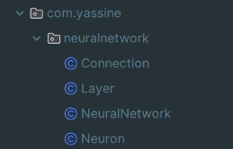
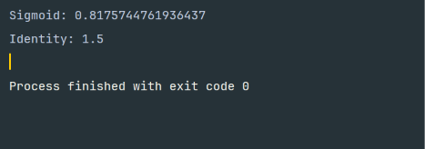
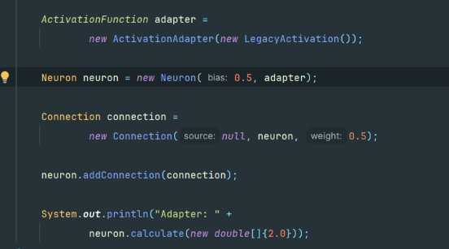
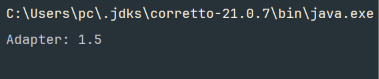
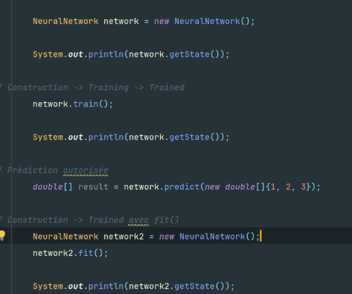
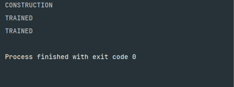
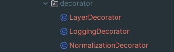
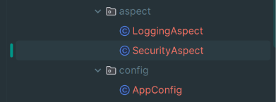
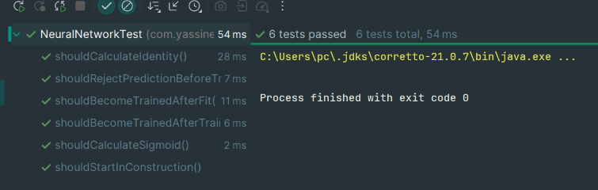

# Neural Network - Design Patterns

## Description
Object-oriented implementation of an artificial neural network
using Java and Design Patterns.

## Design Patterns
- Strategy
- Adapter
- State
- Observer
- Decorator
- Aspect-oriented programming (Logging and Security)

## Technologies
- Java 21
- Maven
- JUnit
- AspectJ

# based architecture 

# Strategy

# Adapter

# State 

# Observer

# Decorator

# AOP logging and security aspects

# Test

